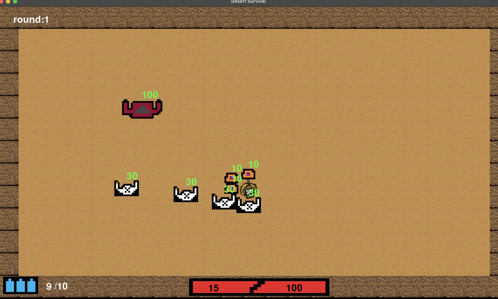
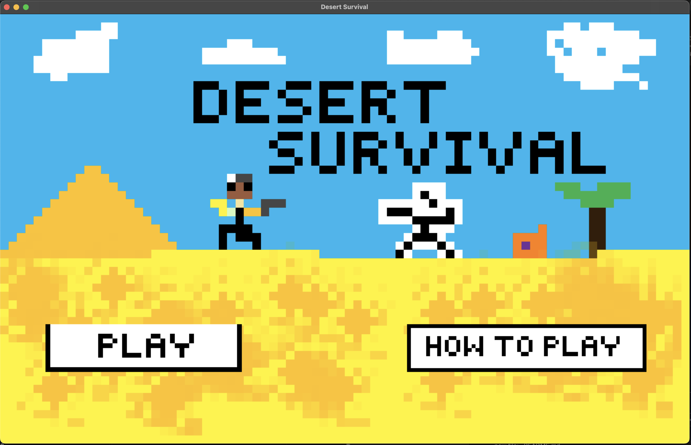
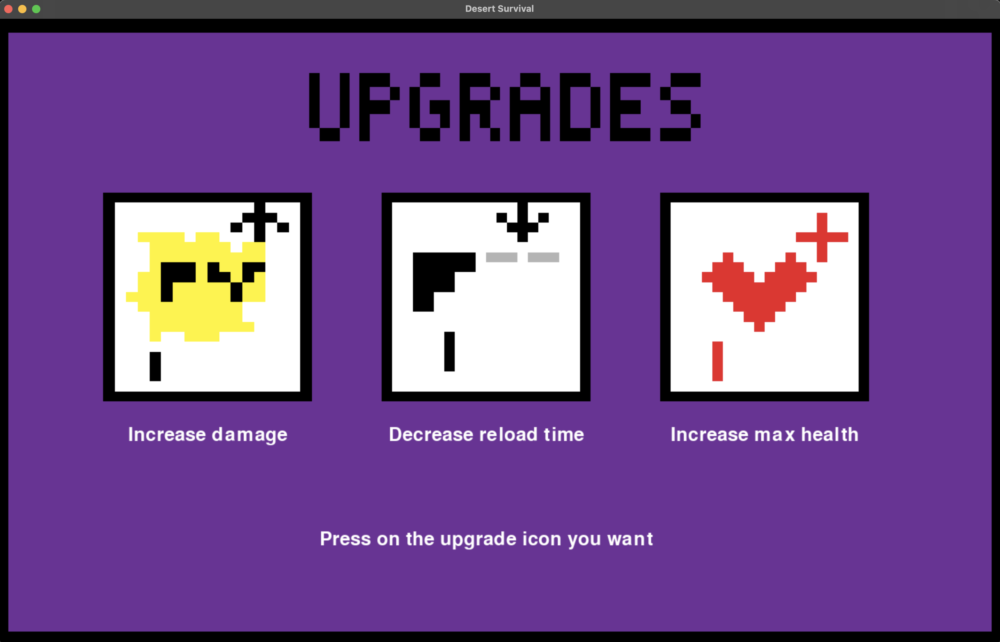

Desert Survival

Overview
This is a 2d top down shooter game inspired from rougelike games. It is made using Python and Pygame. The game features multiple stages, random levels, enemy encouters, projectile based combat and upgrades.

Features
Player Mechanics - Player movement and shooting
Enenmy Mechanics - enemy beahvior, interactions and collision detection
Stage Proggression - Increased difficulty and stage made on a tile based map
Physics - Collision detection and projectiles
User Interface - HUD and menu screens

Gameplay Screenshots

Future Improvements

More refined graphics
Ranged enemy + different enemmies
Additional Map
Different sized map